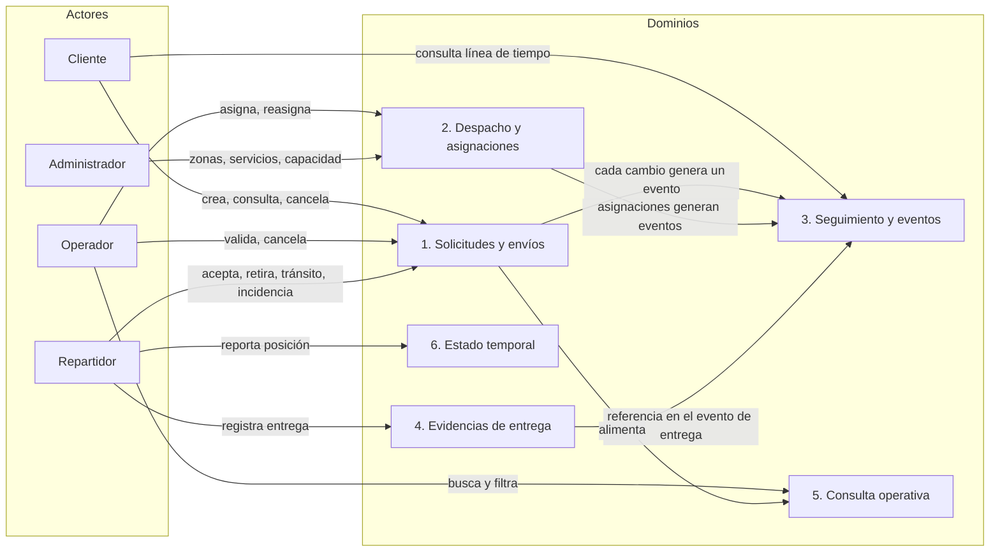
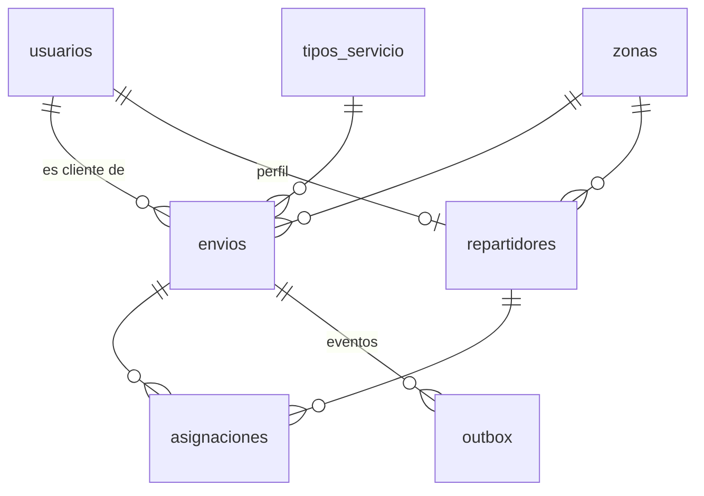
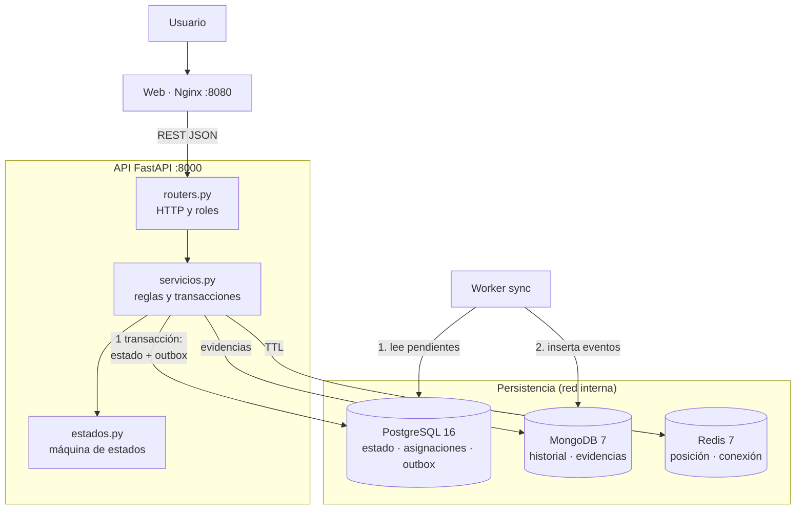
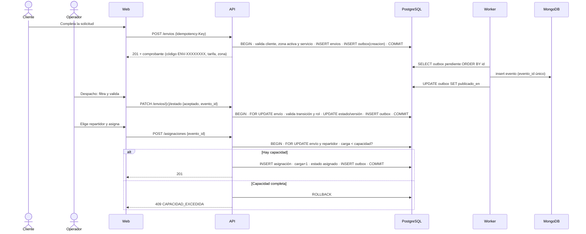
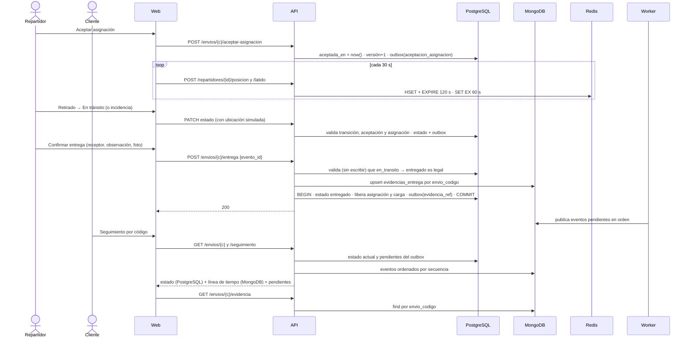
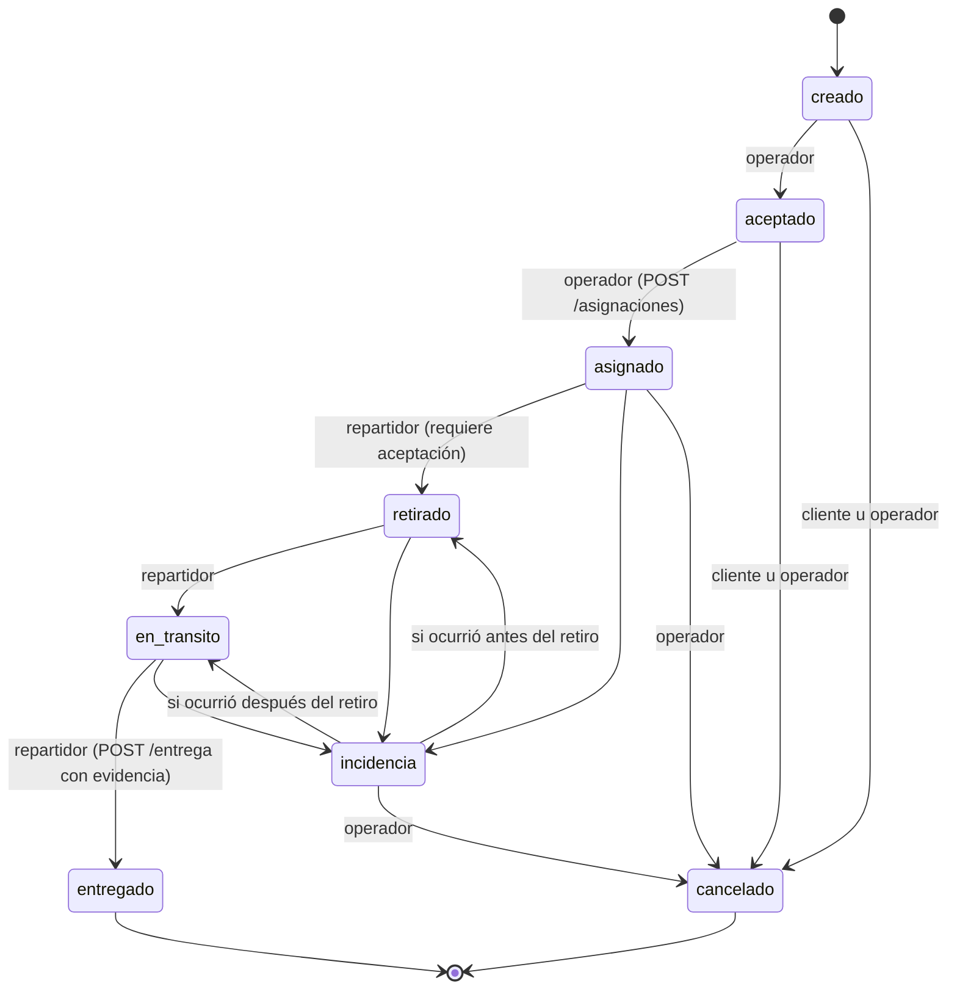

# Informe técnico · Proyecto B: Empresa de mensajería urbana

**Caso 2:** Registro de envíos, seguimiento y despacho
**Asignatura:** Gestión de datos · Proyecto final I Parcial · Persistencia políglota · ESPE
> Los diagramas también están como imágenes en `docs/diagramas/` para insertarlos en Word.

**Equipo:** Integrante 1 (servidores y bases de datos), Integrante 2 (API REST y transacciones), Integrante 3 (frontend)

---

## 1. Contexto

Una empresa de entregas urbanas requiere una web para registrar paquetes, asignarlos a repartidores y ofrecer seguimiento de cada envío. Se definieron cuatro roles: el **cliente** crea solicitudes y consulta su seguimiento; el **operador** valida solicitudes, asigna repartidores y gestiona incidencias; el **repartidor** acepta asignaciones, reporta estados y registra la evidencia de entrega; y el **administrador** mantiene zonas, tipos de servicio y capacidades.

Se trabajó exclusivamente con datos ficticios: remitentes, destinatarios, direcciones, coordenadas y evidencias son inventados. No se integraron mapas comerciales, GPS real ni pagos.

La solución se implementó con tres tecnologías de persistencia de modelos distintos (relacional, documental y clave-valor), una API REST como único punto de entrada, un sincronizador entre gestores y una interfaz web, todo ejecutado con Docker Compose.

## 2. Mapa de dominios



| Dominio | Datos | Operaciones implementadas |
| --- | --- | --- |
| Solicitudes y envíos | Origen y destino ficticios, remitente, destinatario, tipo de servicio, código único `ENV-XXXXXXXX`, estado vigente y versión | Crear (con comprobante), validar, consultar, cancelar según rol y estado |
| Despacho y asignaciones | Repartidor, zona, capacidad máxima, carga actual, asignación activa única, aceptación | Asignar, aceptar, reasignar, liberar capacidad al entregar o cancelar |
| Seguimiento y eventos | Secuencia ordenada de eventos con estado anterior y nuevo, actor, nota y ubicación simulada | Registrar retiro, tránsito, incidencia y entrega; consultar línea de tiempo |
| Evidencias de entrega | Receptor, observación, referencia de foto simulada, firma simulada y campos variables | Registrar y consultar prueba de entrega |
| Consulta operativa | Código, zona, estado, destinatario y fecha | Buscar, filtrar, paginar |
| Estado temporal | Última posición simulada y conexión del repartidor | Actualizar, consultar, expirar (dato no vigente) |

## 3. Análisis comparativo y selección de gestores

Para cada dominio se compararon al menos dos alternativas con los criterios del enunciado. No se añadió un cuarto motor porque ningún dominio lo justificaba al volumen del caso.

### 3.1 Solicitudes y envíos

| Criterio | Análisis |
| --- | --- |
| Patrón de acceso | Escrituras transaccionales y transiciones de estado concurrentes; lectura por código único |
| Estructura | Muy estructurada, con relaciones a cliente, zona, tipo de servicio y repartidor |
| Consistencia | Fuerte: el estado vigente y el código no admiten ambigüedad |
| Volumen | Medio, crecimiento lineal |
| Disponibilidad | Se prioriza consistencia sobre disponibilidad |
| **Seleccionado** | **PostgreSQL 16** |
| Descartado | MongoDB 7 |
| Justificación | Se requieren ACID, claves foráneas, ENUM de estados, `CHECK` y `UNIQUE`. En MongoDB esas reglas quedarían en la aplicación. |

### 3.2 Despacho y asignaciones

| Criterio | Análisis |
| --- | --- |
| Patrón de acceso | Asignaciones concurrentes sobre la capacidad de un mismo repartidor |
| Estructura | Relacional: repartidor, capacidad, carga, vínculo con envío |
| Consistencia | Fuerte: no se puede exceder la capacidad ni duplicar la asignación activa |
| Volumen | Bajo a medio |
| Disponibilidad | Alta, pero subordinada a la consistencia |
| **Seleccionado** | **PostgreSQL 16** (mismo motor que envíos) |
| Descartado | Redis 7 |
| Justificación | Una asignación inserta la fila, incrementa la carga y cambia el estado del envío en una sola transacción, con bloqueo de fila e índice único parcial. Redis no ofrece atomicidad entre ese dato y el estado del envío, que vive en otro gestor. |

### 3.3 Seguimiento y eventos

| Criterio | Análisis |
| --- | --- |
| Patrón de acceso | Solo inserciones; lectura de la línea de tiempo completa de un envío ordenada por secuencia |
| Estructura | Semiestructurada: según el tipo de evento varían los atributos (ubicación, repartidor, referencia a evidencia) |
| Consistencia | El historial no puede contradecir el estado actual; se tolera retraso en la vista de lectura |
| Volumen | El mayor del sistema: varios eventos por envío |
| Disponibilidad | La consulta del historial debe seguir respondiendo aunque falle su vista |
| **Seleccionado** | **Eventos inmutables**: registro oficial en el `outbox` de PostgreSQL y proyección de lectura en **MongoDB 7** |
| Descartados | (a) Tabla relacional de historial como única fuente de lectura; (b) escribir el evento directamente en MongoDB desde la API |
| Justificación | (b) produce doble escritura sin transacción común: si MongoDB falla después del `COMMIT`, el historial contradice el estado. Escribir el evento en el outbox, en la misma transacción que el estado, elimina esa contradicción. La proyección en MongoDB descarga las lecturas del motor transaccional, admite eventos heterogéneos y puede reconstruirse desde el outbox. La sección 10 desarrolla la decisión. |

### 3.4 Evidencias de entrega

| Criterio | Análisis |
| --- | --- |
| Patrón de acceso | Una escritura por entrega; lectura por código de envío |
| Estructura | Heterogénea: campos opcionales y extras variables |
| Consistencia | La evidencia confirmada debe conservarse siempre |
| Volumen | Uno por envío entregado |
| Disponibilidad | Alta |
| **Seleccionado** | **MongoDB 7** (colección `evidencias_entrega`) |
| Descartado | PostgreSQL con columna JSONB |
| Justificación | El documento es autocontenido y su esquema varía; MongoDB lo valida con `$jsonSchema` flexible y lo indexa por `envio_codigo` (único, lo que hace idempotente el registro). JSONB era viable, pero concentraría en el motor transaccional datos que no participan en sus transacciones. |

### 3.5 Consulta operativa

| Criterio | Análisis |
| --- | --- |
| Patrón de acceso | Lecturas con filtros combinados: texto parcial (código, destinatario), zona, estado y rango de fechas |
| Estructura | La misma de `envios` |
| Consistencia | Fuerte: el operador debe ver el estado real para asignar |
| Volumen | Igual al de envíos (miles en el caso) |
| Disponibilidad | Alta |
| **Seleccionado** | **PostgreSQL 16** con `pg_trgm`, índices GIN y compuestos, sin índice derivado |
| Descartado | Elasticsearch como proyección de búsqueda |
| Justificación | Al volumen del caso, PostgreSQL resuelve las búsquedas con índices. Un índice derivado añadiría un cuarto motor, sincronización y retraso sin beneficio medible. Si la búsqueda se separara en el futuro, se alimentaría desde el mismo outbox. |

### 3.6 Estado temporal

| Criterio | Análisis |
| --- | --- |
| Patrón de acceso | Escrituras muy frecuentes (cada 30 s por repartidor) y lecturas por repartidor |
| Estructura | Clave-valor: posición (`lat`, `lng`, `ts`) y conexión |
| Consistencia | Eventual; un dato vencido se marca como no vigente |
| Volumen | Pequeño, proporcional a los repartidores activos |
| Disponibilidad | Si se pierde, solo se pierde información efímera |
| **Seleccionado** | **Redis 7** con TTL y sin persistencia en disco |
| Descartado | PostgreSQL con tarea de limpieza |
| Justificación | Redis ofrece expiración nativa y baja latencia sin cargar el motor transaccional. Se configuró con `--save "" --appendonly no`. |

### 3.7 Resumen de la selección

| Dominio | Gestor | Source of Truth |
| --- | --- | --- |
| Solicitudes y envíos | PostgreSQL | `envios` (estado vigente) |
| Despacho y asignaciones | PostgreSQL | `asignaciones`, `repartidores` |
| Seguimiento y eventos | PostgreSQL (`outbox`) + MongoDB (proyección) | `outbox` |
| Evidencias de entrega | MongoDB | `evidencias_entrega` |
| Consulta operativa | PostgreSQL | `envios` (sin copia derivada) |
| Estado temporal | Redis | Redis (efímero, sin respaldo) |

## 4. Modelo de datos

### 4.1 PostgreSQL 16



| Tabla | Clave | Restricciones e índices |
| --- | --- | --- |
| `zonas` | `id` | `nombre` único, `activa` |
| `tipos_servicio` | `id` | `nombre` único, `CHECK (tarifa_base >= 0)`, `CHECK (tiempo_estimado_min > 0)` |
| `usuarios` | `id` UUID | `CHECK (rol IN (...))`, `email` único |
| `repartidores` | `id` UUID | `CHECK (capacidad_max BETWEEN 1 AND 20)`, `CHECK (carga_actual BETWEEN 0 AND capacidad_max)` |
| `envios` | `codigo` | Estado `ENUM`, `version`, `idempotency_key` único, FK a cliente, zona y tipo. Índices: `(estado, zona_id)`, `creado_en DESC`, `cliente_id`, GIN `pg_trgm` sobre `destinatario` y `codigo` |
| `asignaciones` | `id` UUID | `aceptada_en`, `liberado_en`. Índice único parcial `uq_asignacion_activa (envio_codigo) WHERE activa` |
| `outbox` | `id` BIGSERIAL | `evento_id` único, `payload` JSONB, `publicado_en`, `intentos`. Índices: pendientes (`WHERE publicado_en IS NULL`) y `(envio_codigo, id)` |

Fragmento representativo (DDL completo en `db/postgres/init/01_schema.sql`):

```sql
CREATE TABLE asignaciones (
  id UUID PRIMARY KEY DEFAULT gen_random_uuid(),
  envio_codigo VARCHAR(20) NOT NULL REFERENCES envios(codigo),
  repartidor_id UUID NOT NULL REFERENCES repartidores(id),
  activa BOOLEAN NOT NULL DEFAULT true,
  asignado_en TIMESTAMPTZ NOT NULL DEFAULT now(),
  aceptada_en TIMESTAMPTZ,
  liberado_en TIMESTAMPTZ
);
CREATE UNIQUE INDEX uq_asignacion_activa ON asignaciones(envio_codigo) WHERE activa;
```

### 4.2 MongoDB 7

`eventos_seguimiento` (proyección del outbox; solo la escribe el worker):

```json
{
  "evento_id": "ENV-SEED0017-0005",
  "envio_codigo": "ENV-SEED0017",
  "secuencia": 5,
  "tipo": "cambio_estado",
  "estado_anterior": "asignado",
  "estado_nuevo": "retirado",
  "actor": { "id": "44444444-4444-4444-4444-444444444441", "rol": "repartidor" },
  "ubicacion": { "type": "Point", "coordinates": [-78.475, -0.195] },
  "nota": "Paquete retirado en origen",
  "ocurrido_en": "2026-10-31T15:20:00+00:00",
  "registrado_en": "2026-10-31T15:20:00+00:00"
}
```

Índices: `{evento_id: 1}` único (idempotencia del worker), `{envio_codigo: 1, secuencia: 1}` único (orden y unicidad por envío), `{ocurrido_en: -1}`. Tipos de evento: `creacion`, `cambio_estado`, `asignacion`, `aceptacion_asignacion`, `reasignacion`.

`evidencias_entrega` (la escribe la API):

```json
{
  "envio_codigo": "ENV-SEED0017",
  "receptor_nombre": "Martina Zambrano",
  "observacion": "Recibido en recepción del edificio",
  "foto": { "tipo": "referencia", "valor": "evidencias/ENV-SEED0017.jpg" },
  "registrado_por": "44444444-4444-4444-4444-444444444441",
  "registrado_en": "2026-10-31T16:30:00+00:00",
  "extras": { "firma_simulada": true }
}
```

Índice: `{envio_codigo: 1}` único.

### 4.3 Redis 7

| Clave | Tipo | TTL | Contenido |
| --- | --- | --- | --- |
| `repartidor:{id}:posicion` | Hash | 120 s | `lat`, `lng`, `ts` |
| `repartidor:{id}:conexion` | String | 60 s | `online` |

### 4.4 Identificadores compartidos y retención

| Identificador | PostgreSQL | MongoDB | Redis |
| --- | --- | --- | --- |
| Código de envío | `envios.codigo` | `envio_codigo` en ambas colecciones | — |
| Evento | `outbox.evento_id` | `eventos_seguimiento.evento_id` | — |
| Repartidor | `repartidores.id` | `repartidor_id` en eventos de asignación | Parte de la clave |
| Usuario (actor) | `usuarios.id` | `actor.id`, `registrado_por` | — |

| Dato | Retención |
| --- | --- |
| Envíos, asignaciones, outbox | Permanente (los envíos cancelados conservan su historial; el outbox no se borra) |
| Eventos en MongoDB | Permanente; regenerable desde el outbox |
| Evidencias | Permanente |
| Posición y conexión | 120 s y 60 s |

## 5. Source of Truth

| Dato | Fuente oficial | Derivado | Cómo se reconcilia |
| --- | --- | --- | --- |
| Estado actual del envío | `envios.estado` (PostgreSQL) | Último evento del historial | Se escriben en la misma transacción; no pueden divergir |
| Historial de cambios | `outbox` (PostgreSQL, inmutable) | `eventos_seguimiento` (MongoDB) | El worker publica en orden; `worker.reconstruir` regenera MongoDB completo |
| Asignación y capacidad | `asignaciones` y `repartidores` (PostgreSQL) | — | `carga_actual` se mantiene en la misma transacción que la asignación |
| Evidencia confirmada | `evidencias_entrega` (MongoDB) | `evidencia_ref` en el evento de entrega | Upsert por código; la entrega no se confirma sin ella |
| Posición y conexión | Redis | — | Expira; no se recupera ni sustituye a la evidencia |

## 6. Arquitectura e integración



| Gestor | Escribe | Lee |
| --- | --- | --- |
| PostgreSQL | API (envíos, asignaciones, catálogos, outbox); worker (marca `publicado_en`) | API (estado, búsqueda, capacidad, respaldo del historial); worker (outbox) |
| MongoDB | Worker (eventos); API (evidencias) | API (línea de tiempo, evidencias) |
| Redis | API (posición, latido) | API (estado temporal) |

La web nunca se conecta a las bases y no recibe credenciales. Las bases no publican puertos al equipo anfitrión.

## 7. Flujos end-to-end

### 7.1 Registro, validación y asignación con control de capacidad



### 7.2 Recorrido del repartidor, entrega con evidencia y seguimiento



## 8. Transacciones, máquina de estados e idempotencia

### 8.1 Máquina de estados



Reglas explícitas:

- `asignado` y `entregado` solo se alcanzan por sus endpoints específicos, nunca por `PATCH`.
- El repartidor solo mueve envíos que tiene asignados y, antes de retirar, debe aceptar la asignación.
- El cliente solo cancela antes de la asignación; después la cancelación corresponde a operación.
- Al salir de una incidencia se retoma el paso pendiente: no se permite saltar de una incidencia previa al retiro directamente a tránsito.
- La reasignación se permite en `asignado`, `retirado` e `incidencia`; libera la carga del repartidor anterior y exige la aceptación del nuevo.
- `entregado` y `cancelado` son finales y liberan la capacidad. La cancelación no borra nada: el historial se conserva.

### 8.2 Transacción local

Cada operación de escritura se ejecuta como una transacción local de PostgreSQL que bloquea la fila del envío (`SELECT … FOR UPDATE`), valida rol, dueño, asignación y transición, actualiza estado y versión, y escribe la fila del outbox. Las asignaciones bloquean también las filas de los repartidores, siempre en el mismo orden para evitar interbloqueos. No se asume una transacción ACID conjunta con MongoDB ni con Redis.

### 8.3 Validaciones

La API valida tipos y rangos con Pydantic (por ejemplo, coordenadas, longitudes y capacidad entre 1 y 20) y, en el servidor, el rol, el dueño, la zona activa, la capacidad y el estado. No se confía en ningún precio, capacidad o estado enviado por el navegador: la tarifa se lee del catálogo y el estado actual de la base.

### 8.4 Idempotencia y reintentos

| Operación | Mecanismo | Resultado del reintento |
| --- | --- | --- |
| `POST /envios` | Cabecera `Idempotency-Key` con índice único | `200` con el mismo envío |
| Cambios de estado, asignación, aceptación, reasignación, entrega | `evento_id` con índice único en el outbox | `200` con `"ya_aplicado": true`, sin repetir el efecto |
| Evidencia | Upsert por `envio_codigo` | Sobrescribe la misma evidencia |
| Worker | Índice único `evento_id` en MongoDB | El duplicado se ignora y se marca publicado |

### 8.5 Consistencia eventual y recuperación

El historial en MongoDB se actualiza segundos después del cambio de estado. La API informa `pendientes_sincronizacion` y la web muestra un aviso mientras sea mayor que cero. El worker procesa en orden de `outbox.id`; si MongoDB no responde, reintenta en el siguiente ciclo sin perder eventos. Si la proyección se daña, se regenera completa desde el outbox.

La entrega es una saga de dos pasos: primero la evidencia en MongoDB y después el cambio de estado en PostgreSQL. Si el primer paso falla, el envío no cambia (503, reintentable). Si falla el segundo, queda una evidencia sin estado `entregado`, que se sobrescribe en el reintento con el mismo `evento_id`.

## 9. Tabla de consistencia y errores entre dominios

| Operación | Gestores | Consistencia | Fallo posible | Comportamiento | ¿Reintento seguro? |
| --- | --- | --- | --- | --- | --- |
| Crear envío | PostgreSQL | Fuerte | Datos inválidos, zona inactiva | 422 con detalle | Sí, misma `Idempotency-Key` |
| Validar o cancelar | PostgreSQL | Fuerte | Transición o rol inválidos | 409 / 403 | Sí, mismo `evento_id` |
| Asignar | PostgreSQL | Fuerte | Capacidad completa; asignación activa | 409 `CAPACIDAD_EXCEDIDA` / `ENVIO_YA_ASIGNADO` | Sí |
| Retiro, tránsito, incidencia | PostgreSQL | Fuerte | Sin aceptación; no asignado | 409 / 403 | Sí |
| Entrega | MongoDB → PostgreSQL | Saga | MongoDB caído | 503; el envío no cambia | Sí |
| Historial | PostgreSQL → MongoDB | Eventual | Worker detenido | Estado correcto; aviso de pendientes | Automático al volver |
| Historial | MongoDB | Eventual | MongoDB caído | Se sirve desde el outbox | — |
| Evidencia (lectura) | MongoDB | Fuerte por documento | MongoDB caído | 503 | Sí |
| Búsqueda | PostgreSQL | Fuerte | PostgreSQL caído | 503 | Sí |
| Posición y conexión | Redis | Eventual (TTL) | Redis reiniciado | Posición "no vigente"; envíos y entregas intactos | Sí; el repartidor vuelve a reportar |
| Cualquiera | PostgreSQL | — | PostgreSQL caído | 503 controlado; `/health` degradado | Sí |

## 10. Pregunta de investigación

**¿Conviene guardar el seguimiento como registros relacionales, documentos o eventos inmutables?**

**Consultas dominantes.** La consulta principal es recuperar todos los eventos de un envío en orden. En un modelo relacional implica un índice `(envio_codigo, secuencia)` sobre una tabla que crece más que ninguna otra y comparte recursos con las transacciones. En documentos, cada evento se lee directamente por un índice equivalente, con atributos variables (ubicación, repartidor, referencia a evidencia) sin columnas nulas.

**Orden.** El orden se garantiza con la `secuencia`, que es la versión del envío asignada dentro de la misma transacción que bloquea su fila. Ningún modelo garantiza el orden por sí solo; lo que lo asegura es asignarlo donde se serializan las escrituras.

**Auditoría.** Los eventos inmutables registran quién hizo qué, cuándo y desde qué estado, y nunca se modifican. Un registro relacional que se actualiza perdería esa trazabilidad.

**Costes operativos.** Un solo motor relacional es más simple de operar. Separar la lectura en MongoDB añade un worker y un retraso de segundos, pero aísla la carga de consultas de seguimiento y admite eventos heterogéneos.

**Recuperación del estado actual.** Reconstruir el estado reproduciendo todos los eventos en cada lectura sería costoso. Por eso el estado vigente se guarda en una fila relacional, actualizada en la misma transacción que el evento, y los eventos permiten reconstruirlo o auditarlo cuando haga falta.

**Decisión.** Se adoptó un modelo de **eventos inmutables** con dos representaciones: el registro oficial se escribe en el outbox de PostgreSQL (transaccional con el estado), y la vista de lectura se proyecta como **documentos** en MongoDB. Se descartó escribir el historial directamente en MongoDB desde la API, porque sin transacción común el historial podría contradecir el estado; y se descartó usar solo una tabla relacional de historial para la lectura, porque concentraría en el motor transaccional la consulta de mayor volumen.

## 11. Contrato de la API

La especificación completa se entrega en `api/openapi.yaml` (generada desde el código) y en `api/README.md`. Resumen:

| Categoría | Endpoints |
| --- | --- |
| Lectura | `GET /envios/{codigo}`, `/seguimiento`, `/evidencia`, `GET /zonas`, `/tipos-servicio`, `/repartidores`, `/clientes` |
| Escritura | `POST /envios`, `PATCH /envios/{codigo}/estado`, `POST /asignaciones`, `/asignaciones/reasignar`, `/envios/{codigo}/aceptar-asignacion`, `/envios/{codigo}/entrega`, administración de zonas, servicios y capacidad |
| Búsqueda | `GET /envios?q=&estado=&zona_id=&desde=&hasta=&limite=&desplazamiento=` (PostgreSQL con `pg_trgm`) |
| Estado temporal | `POST /repartidores/{id}/posicion`, `/latido`, `GET …/estado-temporal` |
| Salud | `GET /health` (sin secretos), `GET /sincronizacion` |

Todos los errores comparten el formato `{"error": {"codigo", "mensaje", "detalles"}}` con códigos estables (`VALIDACION`, `NO_PERMITIDO`, `NO_ENCONTRADO`, `TRANSICION_INVALIDA`, `CAPACIDAD_EXCEDIDA`, `ENVIO_YA_ASIGNADO`, `CONFLICTO`, `DEPENDENCIA_NO_DISPONIBLE`).

## 12. Despliegue

- `docker-compose.yml` con seis servicios (`postgres`, `mongo`, `redis`, `api`, `worker`, `frontend`), red interna y volúmenes con nombre para PostgreSQL y MongoDB; Redis sin volumen por diseño.
- Variables configurables en `.env` (plantilla `.env.example`); el repositorio no contiene secretos reales.
- Healthchecks en las bases y en la API; la API y el worker esperan a que las bases estén sanas.
- Solo se publican los puertos de la web (8080) y la API (8000).
- Datos semilla: 4 zonas, 3 servicios, 10 usuarios, 4 repartidores y 20 envíos que recorren todos los estados con su historial completo, y evidencias de los entregados.
- Instrucciones de arranque, reinicio y limpieza en `README.md`.

## 13. Validación

### 13.1 Pruebas automatizadas

Se ejecutan con `docker compose exec -e RUN_INTEGRATION=1 api python -m pytest -v`.

| Grupo | Archivo | Cobertura |
| --- | --- | --- |
| Máquina de estados | `test_estados.py` | Transiciones, terminales, roles, cancelación del cliente, salida de incidencia, aceptación, acciones por rol |
| Validación HTTP | `test_http.py` | Errores 422 y 403 antes de tocar la base |
| Integración | `test_integracion.py` | Coherencia de la semilla, comprobante, idempotencia, capacidad y concurrencia, aceptación, incidencia, reasignación, visibilidad, catálogos, respaldo del historial con MongoDB caído, TTL de Redis |

### 13.2 Pruebas demostrables en la defensa

| # | Prueba del enunciado | Cómo se demuestra (detalle en `pruebas_defensa.md`) |
| --- | --- | --- |
| 1 | Código único y consulta posterior | Web (comprobante) o `scripts/demo.py codigo` |
| 2 | Secuencia válida y transición inválida | Recorrido completo en la web; `scripts/demo.py invalida` |
| 3 | Dos asignaciones incompatibles | `scripts/demo.py concurrencia` (201 y 409) |
| 4 | Reinicio del estado temporal | `docker compose restart redis`: posición no vigente, historial intacto |
| 5 | Entrega persistente y caída de la sincronización | `docker compose restart`; `stop worker` / `start worker`; `stop mongo` |

### 13.3 Registro de evidencias

> Completar con capturas tomadas del sistema levantado con `docker compose up --build -d`.

| # | Evidencia | Captura |
| --- | --- | --- |
| E1 | `docker compose ps` con todos los servicios sanos | |
| E2 | Comprobante de un envío nuevo | |
| E3 | Rechazo por capacidad en el despacho | |
| E4 | Recorrido del repartidor (aceptar, retirar, incidencia, tránsito, entrega) | |
| E5 | Seguimiento con línea de tiempo y prueba de entrega | |
| E6 | Aviso de eventos pendientes con el worker detenido y su recuperación | |
| E7 | Historial servido desde el outbox con MongoDB detenido | |
| E8 | Redis vacío tras reinicio y posición "no vigente" | |
| E9 | Resultado de `pytest` dentro del contenedor | |

## 14. Reflexión: límites y mejoras futuras

- **Autenticación simulada.** La identidad se transmite con cabeceras; en producción se requeriría autenticación real (OAuth2 con JWT) y contraseñas con hash verificable.
- **Archivos de evidencia.** Solo se guarda una referencia; un almacenamiento de objetos (S3 o MinIO) guardaría el binario.
- **Búsqueda a gran escala.** Con millones de envíos convendría una proyección en un motor de búsqueda alimentada desde el mismo outbox, aceptando consistencia eventual.
- **Evidencia huérfana.** Una entrega cuyo segundo paso falla deja una evidencia sin estado `entregado`; un proceso de conciliación podría detectarla.
- **Un solo worker.** Para varios workers en paralelo habría que repartir el outbox con `FOR UPDATE SKIP LOCKED`.
- **Alta disponibilidad.** Cada gestor corre en una sola instancia; réplicas de PostgreSQL y un replica set de MongoDB mejorarían la tolerancia a fallos.
- **Gestión de usuarios y repartidores.** Se cargan por semilla; faltan sus pantallas de alta.

## 15. Preparación ante cambios de requisito

| Cambio posible | Impacto en la arquitectura |
| --- | --- |
| Reprogramar la entrega a otra franja | Nuevo evento `reprogramacion` en el outbox y columna de franja en `envios`; MongoDB lo admite sin cambiar su esquema |
| Separar la búsqueda en un motor dedicado | Segundo consumidor del outbox que alimenta el índice; la búsqueda pasa a ser eventual y la asignación sigue validándose en PostgreSQL |
| Varios paquetes por envío | Tabla `paquetes` relacionada con `envios`; la capacidad se mediría en paquetes |
| Notificar al cliente en cada cambio | Otro consumidor del outbox (correo o push simulados), sin tocar las transacciones |
| Capacidad por peso en vez de cantidad | Cambiar el `CHECK` y la condición de la asignación; el bloqueo de fila sigue garantizando la concurrencia |
