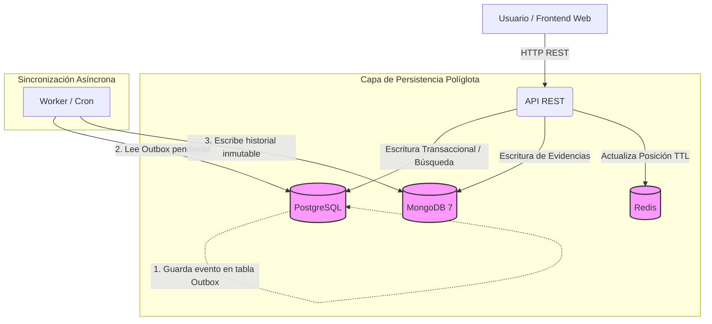

# Proyecto B · Integrante 1: Servidores y Bases de Datos

Persistencia políglota · Empresa de mensajería urbana · ESPE

> Documento de trabajo del integrante 1, actualizado al estado final del código. La versión consolidada para entregar es `docs/informe_tecnico.md`.

## 1. Alcance del integrante 1

Responsable de toda la capa de persistencia y despliegue:

- Selección y justificación de los gestores para los 6 dominios.
- Modelo de datos (PostgreSQL, MongoDB 7, Redis).
- `docker-compose.yml`, Dockerfiles, `.env.example`, volúmenes, red interna y healthchecks.
- Datos semilla.
- Sincronizador (outbox → MongoDB), junto con el integrante 2.
- Pruebas de reinicio, persistencia y recuperación.
- Partes del informe técnico que le corresponden (sección 11).

## 1.1 Diagrama de Arquitectura Lógica



## 2. Resumen de decisiones

| # | Dominio | Gestor elegido | Alternativa descartada | Source of Truth |
| --- | --- | --- | --- | --- |
| 1 | Solicitudes y envíos | PostgreSQL | MongoDB | PostgreSQL (estado actual) |
| 2 | Despacho y asignaciones | PostgreSQL | Redis | PostgreSQL |
| 3 | Seguimiento y eventos | Outbox en PostgreSQL + proyección en MongoDB 7 | Solo tabla relacional de historial | PostgreSQL `outbox` (MongoDB es vista de lectura reconstruible) |
| 4 | Evidencias de entrega | MongoDB 7 | PostgreSQL con JSONB | MongoDB |
| 5 | Consulta operativa | PostgreSQL (pg_trgm/GIN) | Elasticsearch | PostgreSQL |
| 6 | Estado temporal | Redis con TTL | PostgreSQL con job de limpieza | Redis (efímero, sin persistencia) |

Motores: **PostgreSQL, MongoDB 7, Redis** (cumpliendo el mínimo exigido de 3). Al unificar la consulta operativa en PostgreSQL, simplificamos la arquitectura y evitamos el sobrecoste de mantener un motor de búsqueda adicional sin una necesidad real de volumen masivo.

## 3. Matriz de selección por dominio

### 3.1 Solicitudes y envíos

| Criterio | Análisis |
| --- | --- |
| Patrón de acceso | Escrituras transaccionales (crear, aceptar, cancelar), lecturas por código único, transiciones de estado concurrentes. |
| Estructura | Muy estructurada y con relaciones: cliente, zona, tipo de servicio, repartidor. |
| Consistencia | Fuerte: el estado vigente y el código único no admiten ambigüedad. |
| Volumen | Medio, crecimiento lineal; sin necesidad de sharding. |
| Disponibilidad | Alta, pero priorizando consistencia sobre disponibilidad ante partición. |
| **Elegido** | **PostgreSQL** |
| Descartado | MongoDB |
| Justificación | ACID, claves foráneas, ENUM de estados, restricciones CHECK y UNIQUE. MongoDB admitiría el modelo, pero las reglas de integridad quedarían a cargo de la aplicación. |

### 3.2 Despacho y asignaciones

| Criterio | Análisis |
| --- | --- |
| Patrón de acceso | Lecturas de repartidores disponibles y escrituras concurrentes de asignación. |
| Estructura | Relacional: repartidor, capacidad, carga actual, vínculo con envío activo. |
| Consistencia | Fuerte: dos asignaciones simultáneas no pueden exceder la capacidad ni duplicar el envío activo. |
| Volumen | Bajo a medio. |
| Disponibilidad | Alta. |
| **Elegido** | **PostgreSQL** (mismo motor que envíos) |
| Descartado | Redis |
| Justificación | Se necesita una única transacción que inserte la asignación, incremente la carga y cambie el estado del envío. Con un índice único parcial y un `UPDATE` condicionado, la regla la impone la base de datos. Redis no daría atomicidad entre estas tres escrituras. |

### 3.3 Seguimiento y eventos

| Criterio | Análisis |
| --- | --- |
| Patrón de acceso | Inserciones continuas, nunca actualizaciones; lectura de la línea de tiempo de un envío ordenada por secuencia. |
| Estructura | Semiestructurada: según el tipo cambian los atributos y la ubicación simulada. |
| Consistencia | Eventual respecto al estado actual; orden estricto dentro de un envío. |
| Volumen | Alto: muchos eventos por envío, es la tabla que más crece. |
| Disponibilidad | Alta, con escritura simple y escalable. |
| **Elegido** | **MongoDB 7** (colección append-only) |
| Descartado | PostgreSQL relacional |
| Justificación | Los eventos son inmutables. Se escriben primero en el `outbox` de PostgreSQL, en la misma transacción que el cambio de estado (registro oficial y auditable), y el worker los proyecta a MongoDB, donde la línea de tiempo se lee en un solo documento por evento con índice `(envio_codigo, secuencia)`. Si MongoDB se pierde, se reconstruye desde el outbox. |

### 3.4 Evidencias de entrega

| Criterio | Análisis |
| --- | --- |
| Patrón de acceso | Una escritura por entrega, lectura por código de envío. |
| Estructura | Heterogénea: nombre del receptor, observación, foto simulada. |
| Consistencia | Fuerte para conservar la prueba confirmada, sin necesidad de joins. |
| Volumen | Medio (uno por envío entregado). |
| Disponibilidad | Alta. |
| **Elegido** | **MongoDB 7** |
| Descartado | PostgreSQL con JSONB |
| Justificación | Documento autocontenido. Comparte motor con los eventos y evita un modelo adicional. |

### 3.5 Consulta operativa

| Criterio | Análisis |
| --- | --- |
| Patrón de acceso | Lecturas intensivas con filtros combinados: código, zona, estado, destinatario (texto) y fecha. |
| Estructura | Estructurada, consultando la tabla de envíos. |
| Consistencia | Fuerte (al residir en el mismo motor transaccional). |
| Volumen | Igual al de envíos. |
| Disponibilidad | Alta. |
| **Elegido** | **PostgreSQL** con `pg_trgm` e índices GIN |
| Descartado | Elasticsearch |
| Justificación | Simplifica la arquitectura cumpliendo con los 3 motores exigidos. PostgreSQL maneja eficientemente la búsqueda de texto completo y consultas multicampo (índices compuestos y GIN) para el alcance de este laboratorio. |

### 3.6 Estado temporal

| Criterio | Análisis |
| --- | --- |
| Patrón de acceso | Escrituras muy frecuentes y lecturas por repartidor; el dato se vuelve inválido solo. |
| Estructura | Clave-valor simple: última posición simulada y estado de conexión. |
| Consistencia | Eventual; un dato desactualizado se marca como no vigente. |
| Volumen | Pequeño, proporcional al número de repartidores. |
| Disponibilidad | Si cae, se pierde solo lo efímero. |
| **Elegido** | **Redis** con TTL |
| Descartado | PostgreSQL con job de limpieza |
| Justificación | TTL nativo, latencia baja y sin carga sobre el motor transaccional. Configurado sin persistencia (sin RDB ni AOF). |

## 4. Source of Truth y consistencia

| Dato | Fuente oficial | Derivados | Política |
| --- | --- | --- | --- |
| Estado actual del envío | PostgreSQL `envios.estado` | Último evento del historial | Se actualiza en la misma transacción que la fila del outbox: nunca se contradicen. |
| Historial de cambios | PostgreSQL `outbox` (inmutable) | MongoDB `eventos_seguimiento` | Proyección eventual; se reconstruye con `python -m worker.reconstruir`. Si MongoDB cae, la API lee el historial del outbox. |
| Asignación y capacidad | PostgreSQL | Ninguno | Transacción local, control concurrente. |
| Evidencia confirmada | MongoDB `evidencias_entrega` | Referencia en el evento | Se conserva siempre; no es dato efímero. |
| Posición y conexión | Redis | Ninguno | Expira; no se recupera. |

### 4.1 Problema de doble escritura y solución: outbox transaccional

No hay ACID conjunto entre PostgreSQL y MongoDB. Para evitar que el estado actual contradiga el historial:

1. En **una sola transacción** de PostgreSQL: se valida la transición, se actualiza `envios.estado` y se inserta una fila en `outbox` con el evento.
2. Un **worker sincronizador** lee filas de `outbox` no publicadas y las escribe en MongoDB de forma **idempotente** (índice único `evento_id`).
3. Al terminar marca `publicado_en`. Si falla, reintenta; el reintento no duplica.

### 4.2 Orden de escritura para la entrega (saga simple)

1. La API **primero** guarda la evidencia en MongoDB (upsert por `envio_codigo`).
2. **Después** ejecuta la transacción en PostgreSQL: estado `entregado` más fila en `outbox`.

## 5. Modelo de datos

### 5.1 PostgreSQL

El DDL completo está en `db/postgres/init/01_schema.sql`. Tablas:

| Tabla | Clave | Restricciones e índices relevantes |
| --- | --- | --- |
| `zonas` | `id` | `nombre` único, `activa` |
| `tipos_servicio` | `id` | `nombre` único, `CHECK` de tarifa ≥ 0 y tiempo > 0 |
| `usuarios` | `id` (UUID) | `rol` con `CHECK`, `email` único |
| `repartidores` | `id` (UUID) | `CHECK (carga_actual BETWEEN 0 AND capacidad_max)`, capacidad 1 a 20 |
| `envios` | `codigo` (`ENV-XXXXXXXX`) | `estado` ENUM, `version`, `idempotency_key` único, direcciones ficticias; índices `(estado, zona_id)`, `creado_en DESC`, `cliente_id`, GIN `pg_trgm` en `destinatario` y `codigo` |
| `asignaciones` | `id` (UUID) | `aceptada_en`, `liberado_en`; índice único parcial `uq_asignacion_activa (envio_codigo) WHERE activa` |
| `outbox` | `id` (BIGSERIAL) | `evento_id` único (idempotencia), `payload` JSONB; índices de pendientes y `(envio_codigo, id)` |

Identificadores compartidos entre gestores: `envios.codigo` = `envio_codigo` en MongoDB; `outbox.evento_id` = `eventos_seguimiento.evento_id`; `repartidores.id` forma la clave de Redis.

### 5.2 MongoDB 7

Colección `eventos_seguimiento` (inmutable):

```json
{
  "evento_id": "ENV-000123-0003",
  "envio_codigo": "ENV-000123",
  "secuencia": 3,
  "tipo": "cambio_estado",
  "estado_anterior": "asignado",
  "estado_nuevo": "retirado",
  "actor": { "id": "uuid-del-repartidor", "rol": "repartidor" },
  "ubicacion": { "type": "Point", "coordinates": [-78.4678, -0.1807] },
  "nota": "Paquete retirado en origen",
  "ocurrido_en": "2026-11-03T14:20:00Z",
  "registrado_en": "2026-11-03T14:20:02Z"
}
```

Índices: `{evento_id: 1}` único, `{envio_codigo: 1, secuencia: 1}` único, `{ocurrido_en: -1}`. Validación `$jsonSchema` de campos obligatorios. Tipos de evento: `creacion`, `cambio_estado`, `asignacion`, `aceptacion_asignacion`, `reasignacion`. Fechas como texto ISO 8601 UTC, igual que en el outbox.

Colección `evidencias_entrega`:

```json
{
  "envio_codigo": "ENV-000123",
  "receptor_nombre": "Maria Ficticia",
  "observacion": "Entregado en recepción",
  "foto": { "tipo": "referencia", "valor": "evidencias/ENV-000123/foto.jpg" },
  "registrado_por": "uuid-del-repartidor",
  "registrado_en": "2026-11-03T15:02:00Z",
  "extras": { "firma_simulada": true }
}
```

### 5.3 Redis

| Clave | Tipo | TTL | Contenido |
| --- | --- | --- | --- |
| `repartidor:{id}:posicion` | Hash | 120 s | `lat`, `lng`, `ts` |
| `repartidor:{id}:conexion` | String | 60 s | `online` (latido del repartidor) |

Configuración: `--save "" --appendonly no`.

## 6. Docker Compose

Ver `docker-compose.yml` y `.env.example` en la raíz. Puntos clave:

- Seis servicios: `postgres`, `mongo`, `redis`, `api`, `worker`, `frontend`, en la red interna `mensajeria_network`.
- Volúmenes con nombre `mensajeria_pg_data` y `mensajeria_mongo_data`; Redis sin volumen ni persistencia (`--save "" --appendonly no`).
- Las bases **no publican puertos** al equipo: solo la API (8000) y la web (8080).
- Healthchecks en las tres bases y en la API; `api` y `worker` esperan a que las bases estén sanas.

## 7. Datos semilla

Implementados en `db/postgres/init/02_seed.sql` y `db/mongo/init/01_init.js`:
- 4 zonas y 3 tipos de servicio.
- 1 administrador, 2 operadores, 3 clientes y 4 repartidores (capacidades 3, 1, 2 y 5).
- 20 envíos que recorren todos los estados (6 creados, 4 aceptados, 2 asignados, 1 retirado, 2 en tránsito, 1 incidencia, 2 entregados, 2 cancelados), con destinatarios distintos para la búsqueda.
- Cada envío tiene sus eventos en el `outbox`, de modo que estado e historial coinciden; el worker los publica en MongoDB al arrancar. Las asignaciones y la carga de cada repartidor se derivan de esos recorridos.
- Evidencias de los dos envíos entregados en MongoDB.
- Redis arranca vacío a propósito: las posiciones las genera la web del repartidor y caducan solas.

## 8. Fallos y recuperación

| Falla | Efecto | Comportamiento esperado | Recuperación |
| --- | --- | --- | --- |
| Cae el worker | Línea de tiempo atrasada en Mongo | El estado actual sigue correcto en PostgreSQL | Al reiniciar, procesa filas pendientes del outbox |
| Cae MongoDB | Sin evidencias nuevas; historial servido desde el outbox | La entrega responde 503 (no se marca entregado sin evidencia); crear y asignar siguen funcionando | Reintento idempotente al volver; el worker publica lo pendiente |
| Proyección de MongoDB perdida o dañada | Línea de tiempo incompleta | El estado actual no se ve afectado | `docker compose exec worker python -m worker.reconstruir` |
| Reinicio de Redis | Se pierden posiciones y conexión | Se muestran como no vigentes; historial y entregas intactos | Los repartidores vuelven a reportar |
| Reinicio de PostgreSQL | Interrupción del sistema | La API rechaza peticiones limpiamente | Automática por volumen y healthcheck |

## 9. Pruebas a cargo del integrante 1

| # | Prueba | Cómo demostrarla |
| --- | --- | --- |
| 1 | Persistencia tras reinicio | `docker compose restart` y consulta de envíos, eventos y evidencias: siguen presentes |
| 2 | Redis efímero | `docker compose restart redis`: posiciones desaparecen y la API las marca no vigentes |
| 3 | Caída de sincronización | `docker compose stop worker`, cambiar estados de envío. Comprobar que PostgreSQL actualiza pero MongoDB no. Reiniciar worker y ver sincronización. |
| 4 | Unicidad de asignación | `INSERT` de una segunda asignación activa para `ENV-SEED0012`: falla por `uq_asignacion_activa` |
| 5 | Restricción de capacidad | `python scripts/demo.py concurrencia`: con la Bici (capacidad 1), una asignación 201 y otra 409 |
| 6 | Arranque limpio | `docker compose down -v` y `docker compose up --build -d` con datos semilla cargados |

## 10. Contrato de datos con el integrante 2 (API)

| Elemento | Acuerdo |
| --- | --- |
| Tablas PostgreSQL | Las de la sección 5.1; cambios solo por acuerdo, con migración numerada |
| Outbox | La API escribe en `outbox` dentro de la misma transacción; el worker la consume |
| Colecciones MongoDB | `eventos_seguimiento` y `evidencias_entrega`, versión 7. |
| Claves Redis | Prefijos y TTL de 5.3 |
| Quién escribe qué | PostgreSQL: API. MongoDB: worker (eventos) y API (evidencia). Redis: API |
| Quién lee qué | Estado, búsqueda y asignaciones: PostgreSQL. Línea de tiempo y evidencias: MongoDB. Posición: Redis |

## 11. Qué debes redactar en el informe técnico

Tu parte del entregable 3, con el apoyo de los diagramas del entregable 4:
1. **Mapa de dominios**.
2. **Análisis comparativo de gestores**: matriz de la sección 3.
3. **Selección y justificación**: tabla resumen (sección 2) destacando el descarte de Elasticsearch.
4. **Modelo de datos**: DDL (incluyendo `pg_trgm`), documentos JSON y retención.
5. **Decisiones de Source of Truth** y tabla de consistencia.
6. **Transacciones e idempotencia**: outbox y saga de entrega.
7. **Despliegue**: Diagrama de arquitectura lógica (Sección 1.1), variables de entorno, e instrucciones.
8. **Fallos y recuperación**.
9. **Pregunta de investigación**.
10. **Reflexión**.

## 12. Checklist y orden de trabajo

- [x] Acordar el contrato de datos con el integrante 2.
- [x] Entregar el Compose base el primer día, con PostgreSQL, MongoDB 7, Redis y los volúmenes.
- [x] Esquema SQL, índices GIN y restricciones.
- [x] Colecciones e índices de MongoDB.
- [x] Configuración de Redis sin persistencia.
- [x] Datos semilla.
- [x] Worker sincronizador.
- [x] Pruebas de reinicio y fallos.
- [x] Redacción de tu parte del informe (sección 11).